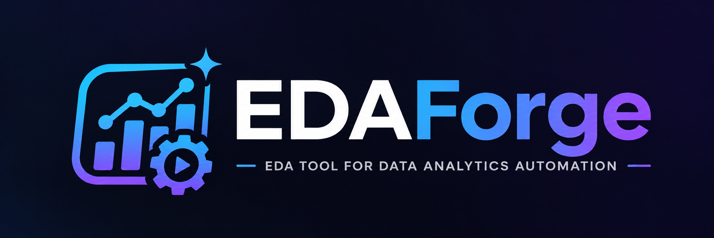
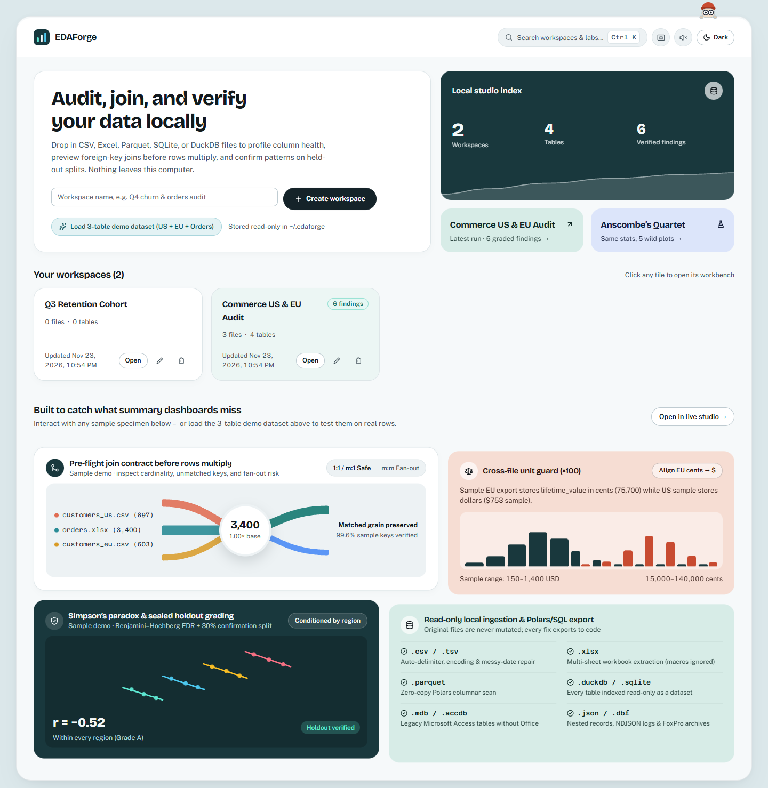
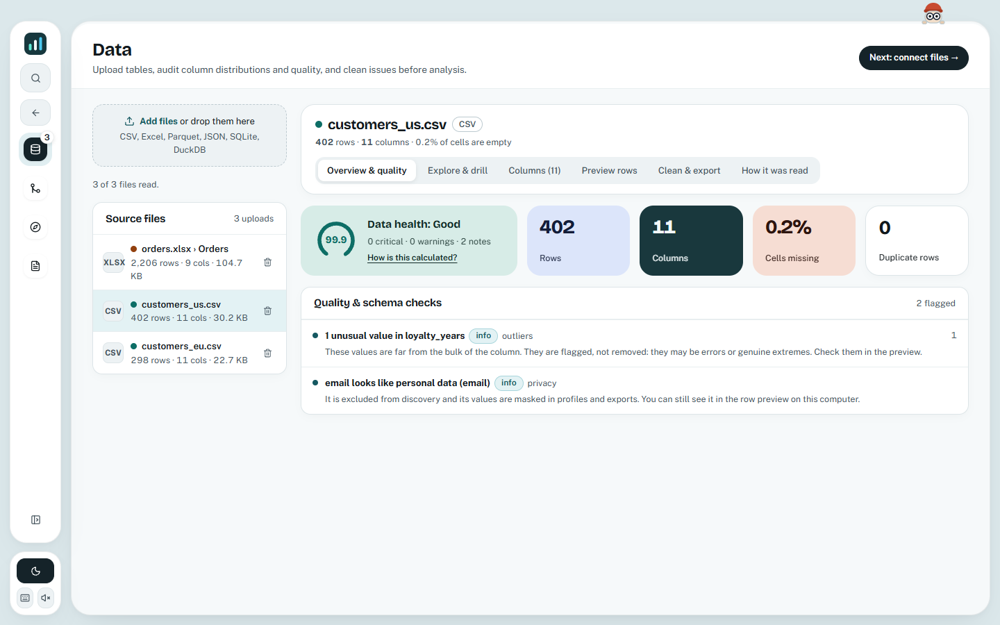
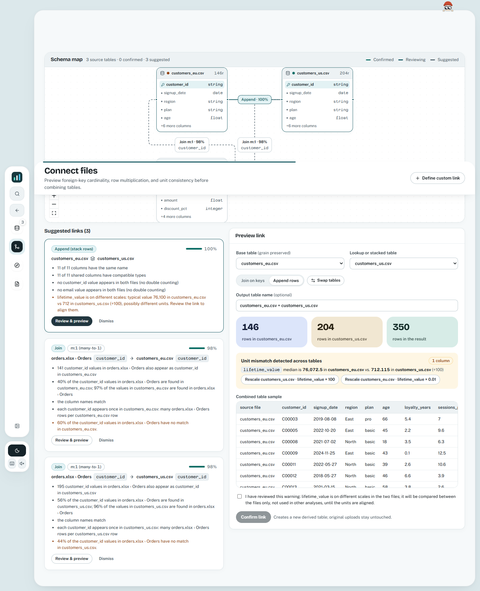
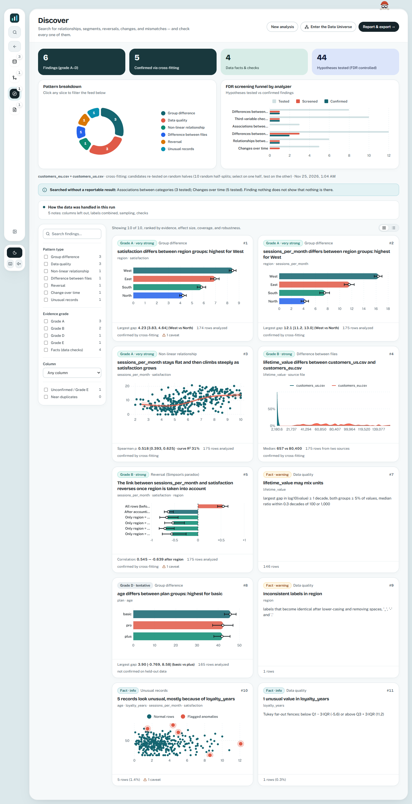
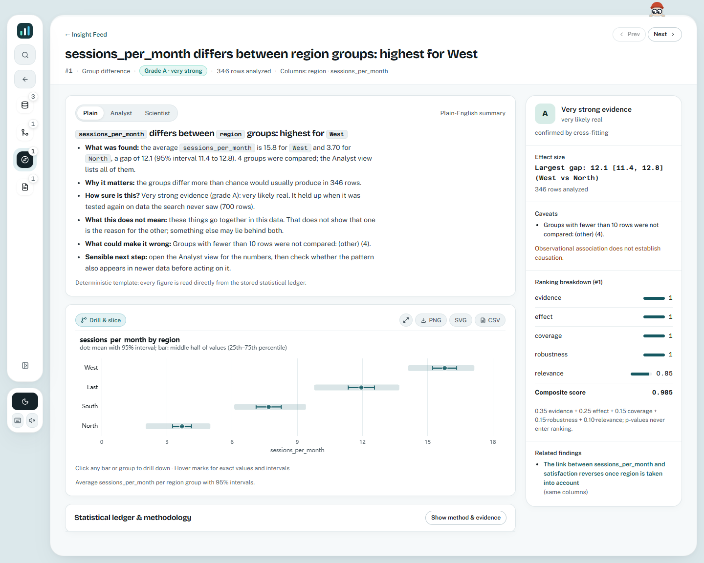
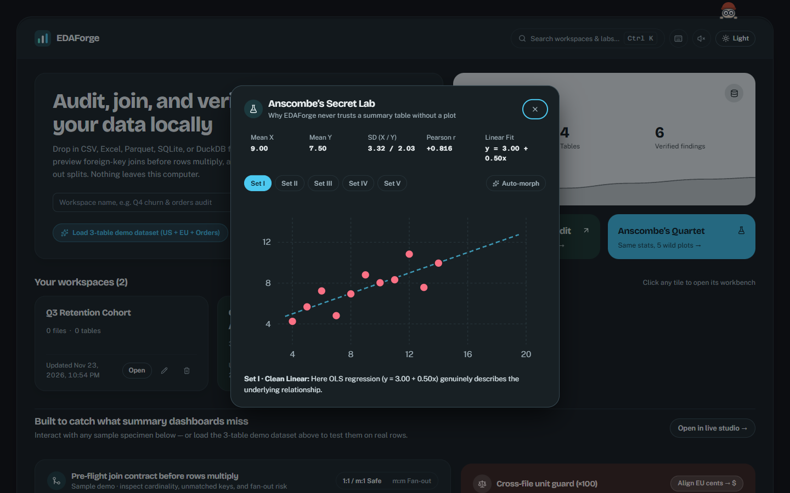

<h1 align="center">EDAForge</h1>

<p align="center">
  
</p>

<p align="center">
  <i>Exploratory data analysis that does the tedious part for you — and runs entirely on your machine.</i>
</p>

<p align="center">
  <a href="#quick-start">Quick start</a> ·
  <a href="#studio-tour">Studio tour</a> ·
  <a href="#what-it-solves">What it solves</a> ·
  <a href="#try-it-with-demo-data">Demo data</a> ·
  <a href="LICENSE">Apache-2.0</a>
</p>

---

## Why EDAForge?

Most of exploratory analysis isn't analysis. It's figuring out why two exports won't line up, finding
the duplicates, noticing that one file is in cents and the other in dollars, and then scrolling
through dozens of charts hoping something jumps out.

EDAForge handles that work. Point it at your files and it will:

- **Show you what's wrong with your data** before it affects your conclusions.
- **Clean and combine** messy files into one dataset you can work with.
- **Surface the patterns that matter**, with a plain-English explanation and a chart for each one.
- **Tell you when there's nothing there**, instead of handing you coincidences.

No cloud account and no uploads to a third party. Your data stays on your computer.

<p align="center">
  <picture>
    <source media="(prefers-color-scheme: dark)" srcset="docs/screenshots/launchpad-dark.png">
    <source media="(prefers-color-scheme: light)" srcset="docs/screenshots/launchpad-light.png">
    
  </picture>
</p>

<p align="center">
  <sub>Dual-World Bento Studio — switches between Light Mineral and Dark Obsidian/Petrol worlds (<code>Shift + T</code>), with 1-click demo data, <code>Ctrl + K</code> command palette, and interactive statistical specimens.</sub>
</p>

## What it solves

| The problem | What EDAForge does |
|---|---|
| *"I don't know what's in this file yet."* | Profiles every column: types, ranges, missing values, odd labels, and outliers. |
| *"The data is messy."* | Flags duplicates, inconsistent categories, missing values, and unit mismatches, then lets you fix them in a few clicks. |
| *"My data is split across several exports."* | Appends files with matching structure and suggests joins on detected keys. It warns you before a join duplicates rows or mixes units. |
| *"I don't know where to start looking."* | Searches the dataset for relationships, group differences, segments, trends, and sudden changes, then ranks what it finds. |
| *"Is this pattern real or just noise?"* | Checks each finding against data it hasn't seen, grades it from A to E, and lists the caveats. |
| *"I need to explain this to someone else."* | Writes each finding at three levels (Plain, Analyst, Scientist) and exports reports, charts, and cleaned data. |
| *"I need to reproduce the cleanup later."* | Saves every cleaning step as a recipe you can export as Python (Polars) or SQL. |

## Quick start

```bash
git clone https://github.com/ProbotisOP/EDAForge.git && cd EDAForge
uv sync                                         # Python engine (3.12–3.13)
(cd apps/web && npm install && npm run build)   # web app
uv run python -m edaforge.server                # → http://127.0.0.1:8000
```

Open **http://127.0.0.1:8000**, create a workspace, and drop in a file.

<sub>Requires <a href="https://docs.astral.sh/uv/">uv</a> and Node.js. Optional settings: <code>EDAFORGE_PORT</code> (default 8000), <code>EDAFORGE_HOME</code> (default <code>~/.edaforge</code>), <code>EDAFORGE_MAX_UPLOAD_MB</code> (default 256).</sub>

## Try it with demo data

No dataset handy? Click **Load 3-table demo dataset (US + EU + Orders)** right on the Launchpad to spin up a pre-loaded workspace in 1 click, or generate the files on disk from the terminal:

```bash
uv run python examples/demo/make_demo.py demo-data
```

This creates US customers (`$`), EU customers (`¢`), and multi-year orders with typical real-world issues already planted in them. Watch EDAForge:

- spot that the EU file stores lifetime value in **cents** while the US file uses **dollars** (`×100`)
- catch duplicate orders, negative refunds, unknown customer IDs, and inconsistent region labels
- join orders to customers without silently inflating the row count
- find the planted patterns, such as a price jump on a specific date and a trend that **reverses**
  once you split by region (Simpson's paradox)

---

## Studio tour

<table>
<tr>
<td width="50%" valign="top">

### 1 · Data workbench
<picture>
  <source media="(prefers-color-scheme: dark)" srcset="docs/screenshots/data-dark.png">
  <source media="(prefers-color-scheme: light)" srcset="docs/screenshots/data-light.png">
  
</picture>
<sub>Slim floating icon dock, MUI X radial health <code>Gauge</code>, 5-axis <code>RadarChart</code>, interactive role <code>PieChart</code> donut, completeness <code>BarChart</code>, and drill studio.</sub>

</td>
<td width="50%" valign="top">

### 2 · Connect &amp; unit guard

<sub>Interactive foreign-key schema map, row-multiplication pre-flight preview, and 1-click unit rescaling (<code>× 0.01</code> / <code>× 100</code>) before stacking or joining.</sub>

</td>
</tr>
<tr>
<td width="50%" valign="top">

### 3 · Ranked discovery feed
<picture>
  <source media="(prefers-color-scheme: dark)" srcset="docs/screenshots/discover-dark.png">
  <source media="(prefers-color-scheme: light)" srcset="docs/screenshots/discover-light.png">
  
</picture>
<sub>Benjamini–Hochberg FDR screening funnel, pattern breakdown donut, rounded multi-palette CI bars, dual-gradient density areas, and diverging Simpson's paradox charts.</sub>

</td>
<td width="50%" valign="top">

### 4 · Finding inspector

<sub>Switch between <b>Plain</b>, <b>Analyst</b>, and <b>Scientist</b> lenses, toggle chart views (<code>Bars + CI</code>, <code>Radar</code>, <code>Row Share</code>, <code>Forest + IQR</code>), and inspect the 5-axis ranking <code>RadarChart</code>.</sub>

</td>
</tr>
</table>

<details>
<summary><b>Keyboard chords &amp; Anscombe's Secret Lab</b></summary>

<br>

- Press `?` anywhere to open keyboard navigation chords (`G` then `H` / `D` / `C` / `F` / `R`), `Ctrl + K` for the command palette, `[` / `]` to step through findings, and `Shift + T` to flip between Light and Dark Bento worlds.
- Click the 3-bar **EDAForge** mark 5 times (or press `Shift + A`) to open **Anscombe's Secret Lab** — an interactive morphing playground demonstrating why summary statistics without plots mislead.

<p align="center">
  
</p>

</details>

---


<table>
<tr>
<td width="50%" valign="top">

### Explore
- Click any column to see everything connected to it.
- Each finding comes with a chart, an estimate of its size, and an explanation.
- Calculated columns are kept separate from measured ones, so you don't "discover" your own formulas.

</td>
<td width="50%" valign="top">

### Clean
- One-click fixes for duplicates, labels, missing values, and units.
- Every step is recorded, so you can undo it, review it, or reproduce it.
- Export cleaned data as CSV or Parquet, and the recipe as Python or SQL.

</td>
</tr>
<tr>
<td width="50%" valign="top">

### Combine
- Stack monthly or regional exports into one table.
- Join tables on keys EDAForge detects for you.
- Preview the result first, with warnings about row inflation, unit mismatches, and conflicting values.

</td>
<td width="50%" valign="top">

### Share
- Interactive charts with zoom, pan, hover, and fullscreen.
- Export charts as PNG, SVG, or CSV.
- Reports that state what was found and how much to trust it.

</td>
</tr>
</table>

---

## Works with the files you already have

`.csv` `.tsv` `.xlsx` `.parquet` `.json` `.jsonl`, plus whole databases: **Microsoft Access**
(`.mdb`, `.accdb`), **SQLite**, **DuckDB**, and **dBase/FoxPro** (`.dbf`). Each table in a database
becomes its own dataset.

Files are opened read-only. EDAForge never runs macros or database views.

## Findings you can trust

Search a dataset long enough and something will always look interesting. EDAForge accounts for
that automatically, so you don't have to:

- **Checked against unseen data.** On larger datasets, findings are confirmed on a held-back
  portion of the data before they are reported.
- **Graded A–E.** Each finding is graded for strength and reliability. Results from small datasets
  are labelled exploratory.
- **Sized, not just flagged.** You see how big an effect is and how certain the estimate is, not
  only whether it exists.
- **Honest when there's nothing.** If the data doesn't support a pattern, EDAForge says so.

<details>
<summary><b>Details for statisticians</b></summary>

<br>

- Every test is recorded in a ledger, and Benjamini-Hochberg false-discovery-rate correction is
  applied across the whole search.
- With 2,000 or more rows, 30% of the data is held out for confirmation. With 300–2,000 rows,
  repeated cross-fitting is used. Below that, findings are capped at grade D.
- Findings whose interval includes zero cannot receive grade A or B. Data-quality problems lower
  the grade.
- Near-duplicate columns are grouped and formula-like columns are flagged to avoid redundant
  findings.

</details>

<details>
<summary><b>Architecture</b></summary>

<br>

```
apps/web/             React 19 · TypeScript · Vite · MUI X Charts (@mui/x-charts v9) · React Flow · Motion · Three.js
packages/edaforge/    Python engine (polars · numpy · scipy · scikit-learn · FastAPI)
  ingest/             files and databases
  link/               appends, joins, key and unit detection
  clean/              cleaning recipes and exports
  discovery/          pattern search, ranking, redundancy, formulas
  rigor/              ledger, FDR, data splits, grading, assumptions
  explain/            Plain / Analyst / Scientist explanations
  viz/                interactive chart & drill-down specifications
  server/             local API on 127.0.0.1
DESIGN.md             Dual-World Bento design system & visual tokens
docs/adr/             architecture decision records
```

Core dependencies must use permissive licences. This is enforced by a licence gate
(`license-policy.toml`).

</details>

<details>
<summary><b>Run the tests</b></summary>

<br>

```bash
uv run playwright install chromium       # once, for the browser tests
uv run pytest                            # engine, API, statistics, browser golden path
(cd apps/web && npm run check)           # TypeScript and production build
```

</details>

---

## Roadmap

EDAForge is in early release (0.1). Coming next:

- Compare findings when your data is updated.
- Keep analysis runs across server restarts.
- Faster rendering for very large charts.

## Contributing

Contributions are welcome. See [CONTRIBUTING.md](CONTRIBUTING.md). Significant design changes
should include an ADR in [`docs/adr/`](docs/adr). Report security issues through
[SECURITY.md](SECURITY.md), and see the [Code of Conduct](CODE_OF_CONDUCT.md).

**[Apache-2.0](LICENSE)** · third-party notices in [NOTICE](NOTICE) · cite via [CITATION.cff](CITATION.cff)
